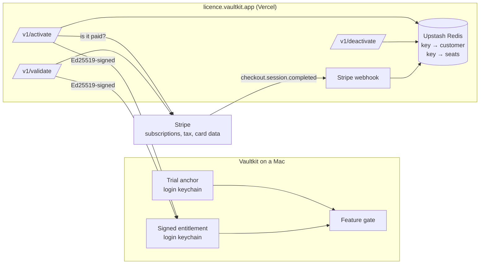

# Vaultkit: Licensing

How the trial, the subscription and the activation service fit together, and
what has to be set up once before a release can be sold.

## The shape of it



Two rules explain most of the design:

**Stripe is the only source of truth for whether someone has paid.** The store
holds which key belongs to which subscription, and which Macs have claimed a
seat. It never holds a status. A refund, a cancellation or a failed card takes
effect on the next check without anything being written back.

**The app trusts a signature, not a server.** Every entitlement is Ed25519-signed
with a key whose private half lives only in the service's environment. The app
carries the public half. A tampered keychain item, a compromised licensing
service or a proxy terminating TLS can all deny a licence; none of them can
grant one.

## What the gate covers

`Feature` in [Sources/Vaultkit/Models/License.swift](../Sources/Vaultkit/Models/License.swift)
is the single list, and it is short on purpose:

| Gated | Never gated |
|---|---|
| Adding an organization | Mounting a vault |
| Cloning into a vault | Ejecting or securing a vault |
| The Scanner | Relocating a misplaced vault |
| The Activity view | Removing an organization |
|  | The Doctor, and every read-only view |

The right-hand column is clause 6 of [LICENSE](../LICENSE), not a product
decision that can be revisited quietly: a lapsed subscription must never stand
between someone and their own encrypted data. `testTheGateNeverCoversReachingYourOwnData`
fails the build if a future change puts `mount`, `eject` or `remove` in `Feature`.

## The trial

Fourteen days, every feature on, no card and no network. The start date is a
keychain item, so it survives deleting the app, and the latest moment ever seen
is recorded alongside it, so winding the clock back does not extend anything.

The anchor is written on the *first read of licence state*, even when that read
ends in a valid licence — otherwise buying on day one and cancelling on day two
would deactivate into a fresh fourteen days.

## Setting it up, once

### 1. The signing key

```bash
cd server && npm install && npm run keygen
```

It prints two things. The private half goes in the service's environment as
`LICENCE_SIGNING_KEY`; the public half replaces `Licensing.signingPublicKey` in
[Sources/Vaultkit/Models/License.swift](../Sources/Vaultkit/Models/License.swift).
`scripts/release.sh` refuses to build a release while the placeholder is still
there.

Rotating this key invalidates every cached entitlement in the field. Apps fall
back to their trial state and re-activate on next launch, so it is recoverable —
but only rotate if the private half leaks.

### 2. Stripe

1. Create a product with a **recurring yearly** price. Its id is `STRIPE_PRICE_ID`.
2. Turn on **Stripe Tax** (Settings → Tax) and register in the jurisdictions your
   sales actually oblige you to. Stripe calculates and collects; it does not
   register or remit for you. Selling direct through Stripe means the tax
   obligations are yours, which is the trade for the lower fees.
3. Add a webhook endpoint at `https://licence.vaultkit.app/api/webhook` subscribed
   to `checkout.session.completed`. Its signing secret is `STRIPE_WEBHOOK_SECRET`.
4. Enable the **billing portal** (Settings → Billing → Customer portal) so
   `/api/portal` has somewhere to send people.

### 3. Deploy

```bash
cd server
vercel link
vercel env add STRIPE_SECRET_KEY        # and the rest of server/.env.example
vercel deploy --prod
```

Add an Upstash Redis store from the Vercel dashboard (Storage → Redis); it sets
`UPSTASH_REDIS_REST_URL` and `UPSTASH_REDIS_REST_TOKEN` for you. Point
`licence.vaultkit.app` at the deployment.

`RESEND_API_KEY` is optional: without it the key still reaches the buyer on the
thank-you page, and is written to the function log.

### 4. The three pages the site needs

- `/buy` — links to `https://licence.vaultkit.app/api/checkout` (a plain link; a
  GET redirects into Stripe Checkout).
- `/thanks?session_id=...` — polls `https://licence.vaultkit.app/api/key?session_id=...`
  until it returns `{ key }`, and shows it. This is what makes a mail failure
  stop being a failed delivery.
- `/account` — a field for a licence key that posts to `/api/portal`.

## Testing the whole path

Use Stripe's test mode keys throughout, and a test card (`4242 4242 4242 4242`).

```bash
# Run the service locally and forward real Stripe events to it.
cd server && vercel dev
stripe listen --forward-to localhost:3000/api/webhook
```

Point the app at it without rebuilding:

```bash
VAULTKIT_LICENCE_URL=http://localhost:3000 swift run
```

Debug builds can move their own clock, so the trial's last week and the paywall
do not take a fortnight to reach:

```bash
VAULTKIT_FAKE_DAYS=0  swift run    # anchor the trial today, then quit
VAULTKIT_FAKE_DAYS=8  swift run    # the banner appears
VAULTKIT_FAKE_DAYS=20 swift run    # the trial is over, the Scanner is locked
```

Those runs keep their keychain items under a `debug.` prefix, so testing the
paywall never burns the real trial on your own machine. Release builds compile
the override out entirely. Do not seed the keychain with `security` instead: an
item written by another program carries that program's ACL, and the app is then
made to prompt for the login password to read its own licence state.

Worth walking through at least once: activate on three machine fingerprints and
check the fourth is refused; cancel the subscription in the dashboard and check
the next `/v1/validate` returns a signed `cancelled` entitlement and the app
lapses on the spot; and pull the network out mid-subscription and confirm the app
keeps working for the offline budget (`Licensing.maxOfflineDays`, 21 days) rather
than locking immediately.

## Distribution

The app is notarized exactly as before — `scripts/release.sh` signs with the
Developer ID, notarizes and staples both the app and the DMG. Going commercial
changes nothing about that pipeline; it is the same Apple Developer account, and
no App Store review is involved. The only changes are the preflight checks at the
top of the script and the copyright string in `Info.plist`.

Because the repository is private, the DMG has to be hosted somewhere the buyer
can reach: a release asset on the private repo works for a handful of customers,
a plain signed URL on your own host scales further. Keep publishing the SHA-256
either way.

## Things deliberately not built

**No machine-locked keys beyond a seat count.** Three seats, released from inside
the app. Hardware-locking beyond that punishes people who replace a Mac far more
often than it stops anyone determined.

**No offline-only licensing.** Online activation was chosen so a leaked key can
be dealt with. The cost is a network dependency, bounded by the offline budget.

**No crack-resistance theatre.** A determined attacker with a debugger wins
against any client-side check, and every hour spent on obfuscation is an hour not
spent on the Scanner. The gate is honest, testable, and cheap to reason about.
